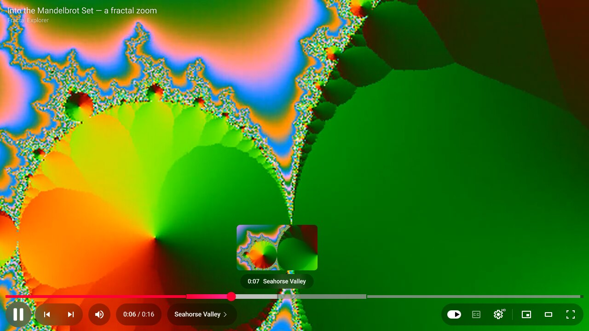
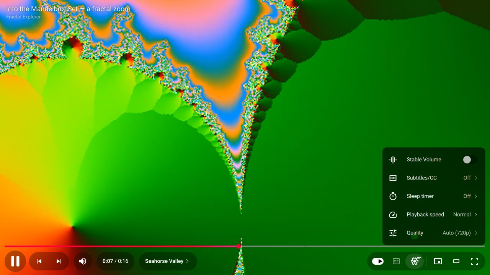
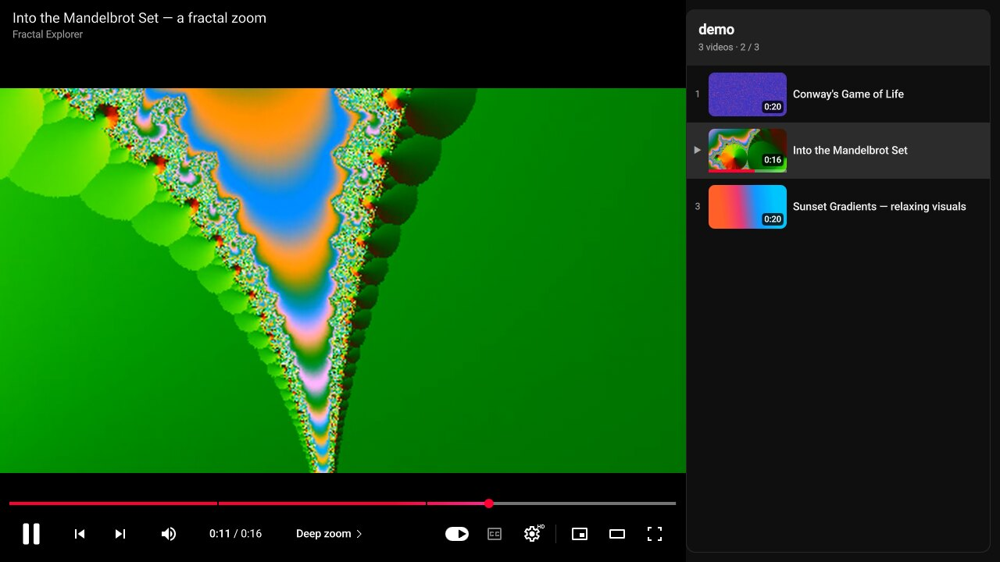
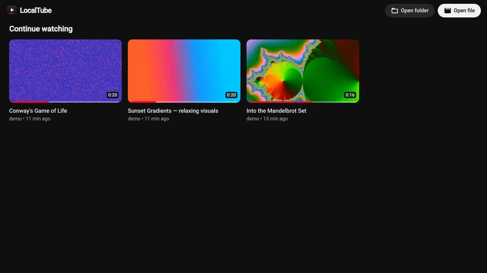

# LocalTube

A video player for downloaded YouTube videos and movies that looks and behaves
like YouTube's current web player, built for Linux (Arch, Wayland/Hyprland or
X11).



| Settings menu | Default view with the folder playlist |
| --- | --- |
|  |  |

| Home screen |
| --- |
|  |

- **Engine:** libmpv. Every common format plays (MP4, MKV, WebM, MOV, AVI…;
  H.264, HEVC, VP9, AV1…). Hardware decoding uses VA-API/NVDEC, zero-copy into
  OpenGL, from 360p to 4K, with HDR10/HLG tone-mapped to SDR.
- **UI:** Qt 6 Quick, rebuilt from YouTube's own player stylesheet: frosted-glass
  pills, the 56 px round play button, the red-to-pink progress bar with chapter
  segments, hover previews, the bezel animations and the settings menu.

## Features

- YouTube controls: play/pause, previous/next, a volume pill that slides out, a
  time display (click it for remaining time), and a chapter pill that opens a
  chapter list. On the right sit the autoplay switch, captions, settings with an
  HD/4K/HDR badge, miniplayer, theater and full screen.
- Seek bar with chapter gaps, buffered range, hover highlight and a growing
  scrubber. Hovering shows a storyboard thumbnail. Thumbnails are generated in
  the background, under the mouse first, and cached on disk.
- Center bezel for play/pause and volume, the "5 seconds" seek indicator, and a
  Material loading spinner.
- Settings: Stable Volume (dynamic loudness normalisation, handy for movies),
  Subtitles/CC (tracks, or add a subtitle file), sleep timer, playback speed
  (presets plus a custom 0.25×–4× slider), Quality and Audio track.
- **Quality → Auto** adapts rendering to your GPU. It watches for dropped
  frames and switches to cheaper scaling/tone-mapping when needed, then probes
  back up, and remembers what works per resolution. High, Balanced and
  Performance can be pinned.
- Captions styled like YouTube's (Roboto on a dark box). They move up while the
  control bar is visible. External `.srt/.vtt/.ass` files next to the video load
  automatically.
- **Resume where you left off**, with red watch-progress bars, like YouTube.
- Folder playlist: opening a file queues the other videos in its folder.
  Autoplay shows the "Up next" countdown, and an end screen offers more videos.
- **Default view** (press `T`) shows an "Up next" panel listing the folder, with
  thumbnails and durations. **Theater mode** gives the video the whole window.
- Home screen with "Continue watching".
- yt-dlp aware: strips `[videoid]` from titles, uses yt-dlp's saved thumbnails
  (`--write-thumbnail` / `--embed-thumbnail`) and metadata (`--embed-metadata`
  supplies title and channel). The right-click menu offers *Copy video URL at
  current time*.
- Right-click menu: Loop, copy links/path, Show in folder, screenshot, open
  file/folder, **Stats for nerds**, keyboard shortcuts.
- Desktop integration: media keys / `playerctl` via MPRIS, the screen stays
  awake while playing (hypridle honours it), drag and drop of files, folders and
  subtitles, and the miniplayer floats and pins itself in a corner on Hyprland.

## Install

These steps are for Arch Linux; every dependency is in the official repos.

**1. Install the dependencies** (most are already there if you use mpv and Qt 6):

```sh
sudo pacman -S --needed git cmake mpv ffmpeg qt6-base qt6-declarative qt6-svg qt6-wayland qt6-shadertools
```

For hardware decoding, also install the VA-API driver for your GPU:
`intel-media-driver` (Intel Broadwell and newer), `libva-mesa-driver` (AMD), or
use the NVIDIA driver (NVDEC). `vainfo` shows whether it works.

**2. Download the code:**

```sh
git clone https://github.com/assil-bouzaine/localtube.git
cd localtube
```

**3. Build and install.** Pick one of the two options.

Option A: install for your user only. No root needed, and keep the `localtube`
folder, since it is used for updating and uninstalling:

```sh
./install.sh
```

This installs `~/.local/bin/localtube` and adds **LocalTube** to your app
launcher. The first build takes a few minutes.

Option B: install system-wide as a pacman package:

```sh
cd packaging/arch
makepkg -si
```

**4. Optional: make LocalTube your default video player.** Opening a video from
your file manager or browser then starts LocalTube:

```sh
xdg-mime default localtube.desktop video/mp4 video/x-m4v video/matroska video/x-matroska \
    video/webm video/quicktime video/vnd.avi video/x-msvideo video/x-ms-wmv video/x-flv \
    video/mpeg video/mp2t video/ogg video/3gpp application/vnd.ms-asf
```

**Updating** to the newest version:

```sh
cd localtube
git pull
./install.sh            # or, for the package: cd packaging/arch && makepkg -si
```

## Uninstall

**1. Remove the app.** Use the method you installed with:

```sh
./install.sh --uninstall      # Option A: run inside the localtube folder
sudo pacman -R localtube      # Option B: the pacman package
```

**2. If LocalTube was your default video player,** give those video types back
to another player, for example mpv:

```sh
xdg-mime default mpv.desktop video/mp4 video/x-m4v video/matroska video/x-matroska \
    video/webm video/quicktime video/vnd.avi video/x-msvideo video/x-ms-wmv video/x-flv \
    video/mpeg video/mp2t video/ogg video/3gpp application/vnd.ms-asf
```

You can also delete the `=localtube.desktop` lines from `~/.config/mimeapps.list`.

**3. Optionally, delete your settings, watch history and cached thumbnails:**

```sh
rm -r ~/.config/localtube ~/.local/share/localtube ~/.cache/localtube
```

Finally, delete the `localtube` folder you cloned.

## Usage

```sh
localtube video.mkv          # plays it; the rest of the folder becomes "Up next"
localtube ~/Videos/Channel   # plays a whole folder
localtube -f movie.mp4       # start in full screen
localtube --mpv-opt hwdec=no file.mp4   # pass any mpv option
```

### Keyboard shortcuts (same as YouTube)

| Key | Action |
| --- | --- |
| `Space` / `K` | Play / pause |
| `J` / `L` | Back / forward 10 s |
| `←` / `→` | Back / forward 5 s |
| `↑` / `↓` | Volume ±5 % (the mouse wheel also works) |
| `M` | Mute |
| `F`, double-click | Full screen |
| `T` | Theater / default view |
| `I` | Miniplayer |
| `C` | Captions on/off |
| `+` / `-` | Caption size |
| `0`–`9` | Jump to 0 %–90 % |
| `Home` / `End` | Start / end |
| `,` / `.` | Previous / next frame (when paused) |
| `<` / `>` | Slower / faster |
| `Ctrl` + `←` / `→` | Previous / next chapter |
| `Shift` + `N` / `P` | Next / previous video |
| `S` | Screenshot (saved to `~/Pictures`) |
| `Ctrl` + `O` | Open file |
| `?` | Show all shortcuts |

## Tips for this hardware

On a weak laptop (e.g. Intel HD 620), decode is the limit, not the player:

- **H.264, HEVC (also 10-bit/HDR) and VP9 (also HDR)** are decoded by the GPU.
  These play 4K60 smoothly (measured: 0–4 dropped frames per 600).
- **AV1 is decoded by the CPU** on GPUs older than Intel 11th gen, RX 6000 or RTX
  30. 1080p is fine, but 4K AV1 won't be smooth. yt-dlp picks AV1 by default when
  available, so ask for VP9 instead:

  ```sh
  yt-dlp -S "vcodec:vp9" --embed-metadata --embed-chapters --embed-thumbnail --sub-langs en --write-subs URL
  ```

## Configuration

- Settings (volume, autoplay, captions, quality, …) are saved automatically in
  `~/.config/localtube/settings.conf`.
- Watch history (resume points) is kept in `~/.local/share/localtube/history.json`.
- Thumbnails and posters are cached in `~/.cache/localtube` (unused previews are
  removed after 45 days).
- For mpv power users, `~/.config/localtube/mpv.conf` is loaded if it exists
  (your regular `~/.config/mpv` setup with uosc etc. is left alone).

### Hyprland

The window's class is `localtube`, for example:

```lua
hl.window_rule({ name = "localtube", match = { class = "^(localtube)$" }, workspace = "4" })
```

## How it is built

| Path | What it does |
| --- | --- |
| `src/mpvobject.*` | libmpv render API in a `QQuickFramebufferObject`; mpv state exposed as QML properties |
| `src/framegrabber.*`, `src/thumbnailer.*` | libavcodec key-frame decoding (with HDR→SDR) for hover previews |
| `src/playlistmodel.*` | Folder playlist, durations and posters |
| `src/history.*` | Resume positions |
| `src/platform.*`, `src/mpris.*` | Dialogs, clipboard, idle inhibit, Hyprland, MPRIS |
| `qml/` | The YouTube interface |
| `shaders/` | Frosted glass and rounded thumbnails |

Video frames are never blocked on by Qt's render thread (`video-timing-offset=0`
plus swap reporting), so the UI animates at the display's refresh rate while
mpv keeps A/V sync.

Roboto is bundled under the SIL Open Font License (`assets/fonts/OFL.txt`).
This is an independent project, not affiliated with YouTube or Google.
